<div align="center">


**The Caelestia desktop look, on the TV in the same room.**

[](https://github.com/J-0-S-E/CaelestiaTV/commits/main)
[](#install)
[](https://github.com/caelestia-dots/shell)
[](https://github.com/Gathin23/cleanyourtv)

[Screenshots](#screenshots) · [Install](#install) · [Make it yours](#make-it-yours) · [Credits](#credits) · [AI declaration](#ai-declaration)

</div>

<br>

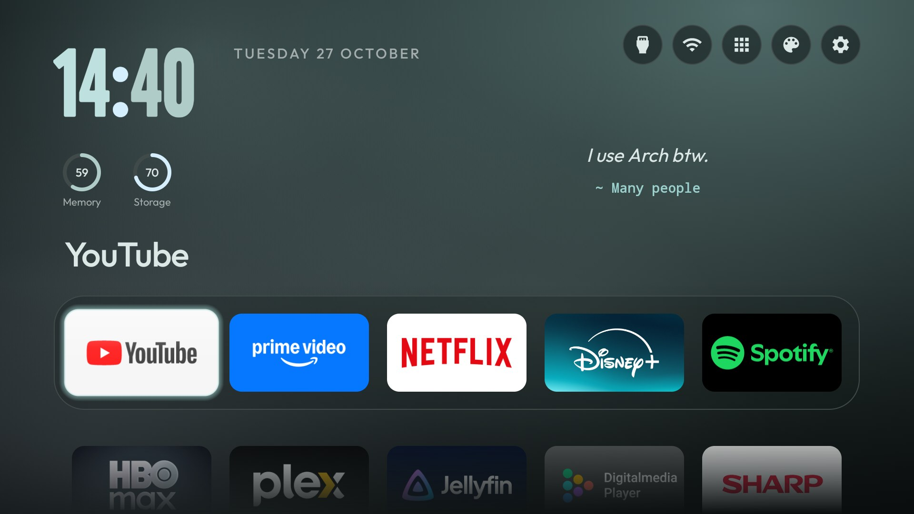

## Why this exists

My PC runs [Caelestia](https://github.com/caelestia-dots/shell) on Hyprland. The TV next to it ran the stock
Android TV home screen: rows of ads, apps I never asked for and a clock you could barely see. So the TV got the
same look as the desktop. Same colour schemes, the same big two-tone clock as the lock screen, and quotes beside it.

It is still a normal smart TV home screen. Your apps are in a dock, the remote works the way you expect, and
nothing is uninstalled.

## What you get

| | |
|---|---|
| **The clock** | Big and bold in Google Sans Flex, like [caelestia-sddm](https://github.com/ItsABigIgloo/caelestia-sddm)'s lock screen. Hours, colon and minutes each take a colour from the scheme |
| **Quotes** | 43 short quotes next to the clock. A new one each time you come back to Home |
| **14 colour schemes** | Caelestia, Dracula, Darkgreen, Catppuccin, Gruvbox, Rosé Pine, Everforest, Nord, Tokyo Night, dark and light. The palette button switches them |
| **Smart dock** | Your apps as their own banners. The ones you use most move to the front, and the next row fades into the bottom of the screen |
| **Screensaver** | Clock, date and a quote in the scheme's colours. It starts after 15 minutes and dims to half after an hour |
| **Light on the TV** | No internet permission, no tracking, about 575 KB. Built and tested on a TV with 1.8 GB of RAM |

## Screenshots

<table>
  <tr>
    <td>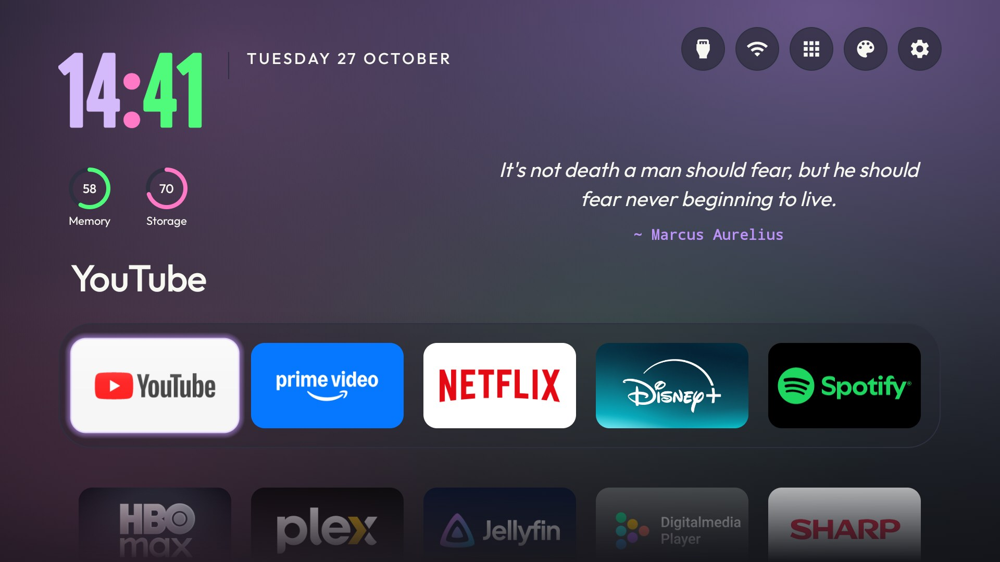</td>
    <td>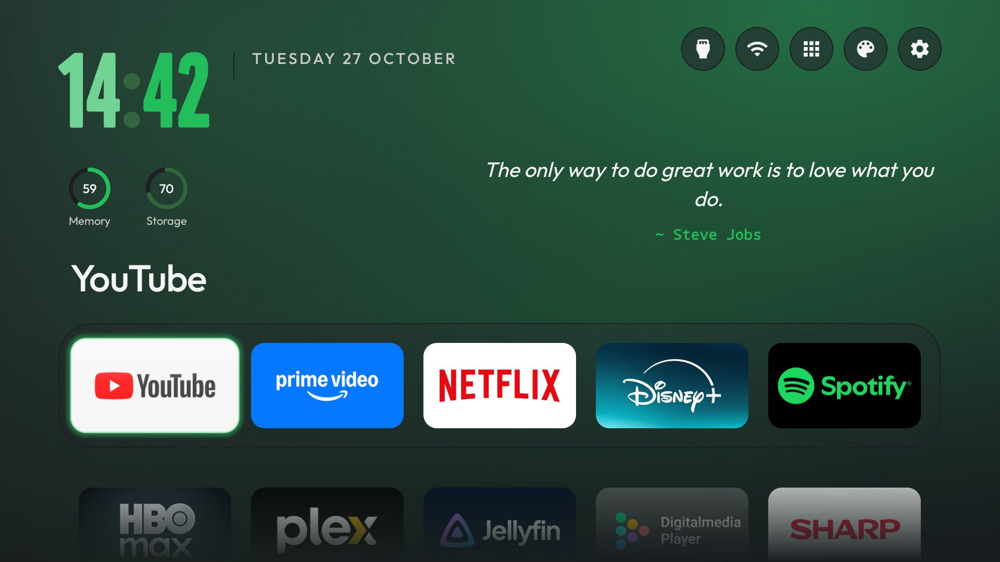</td>
  </tr>
  <tr>
    <td align="center">Dracula dark</td>
    <td align="center">Darkgreen</td>
  </tr>
  <tr>
    <td>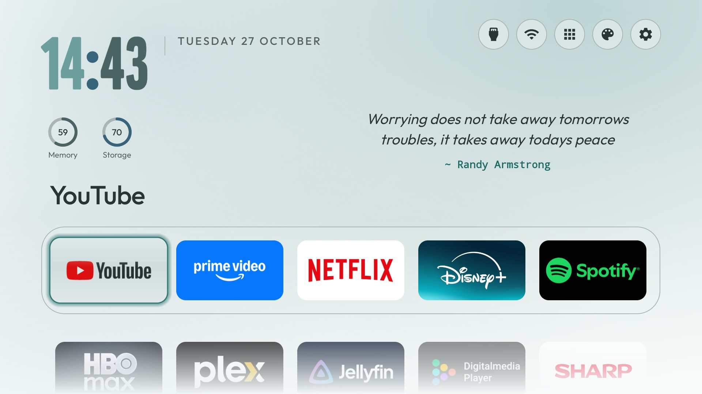</td>
    <td>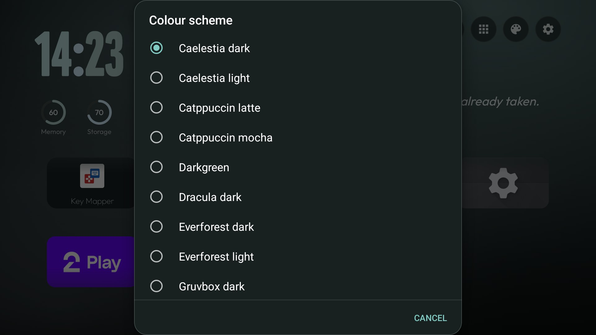</td>
  </tr>
  <tr>
    <td align="center">Caelestia light</td>
    <td align="center">The palette button opens the scheme list</td>
  </tr>
</table>

<details>
<summary><b>The screensaver in eight schemes</b></summary>
<br>

<table>
  <tr>
    <td>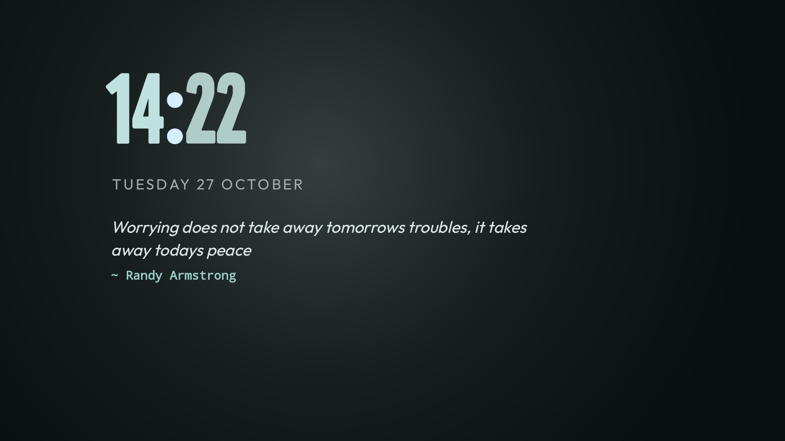</td>
    <td>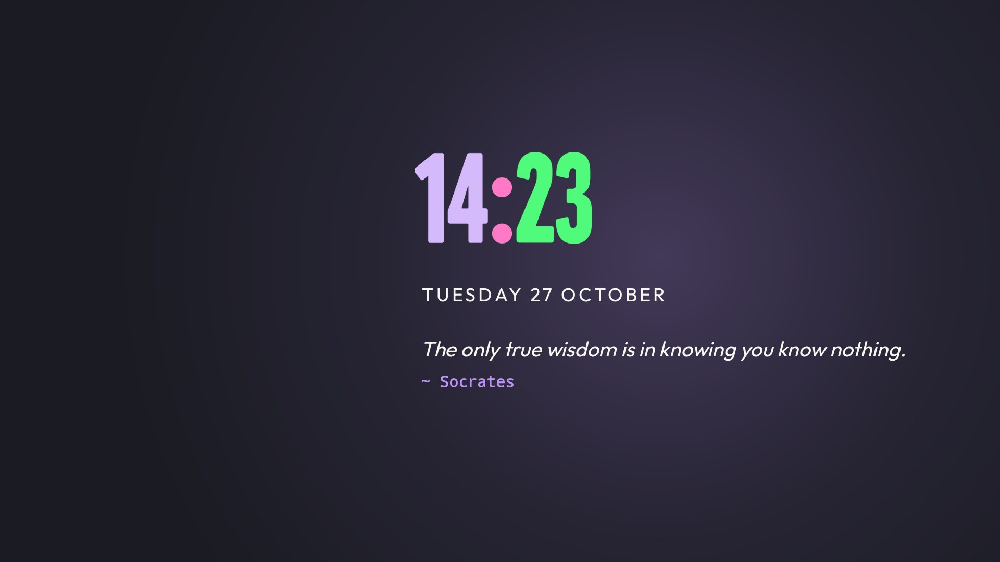</td>
  </tr>
  <tr><td align="center">Caelestia dark</td><td align="center">Dracula dark</td></tr>
  <tr>
    <td>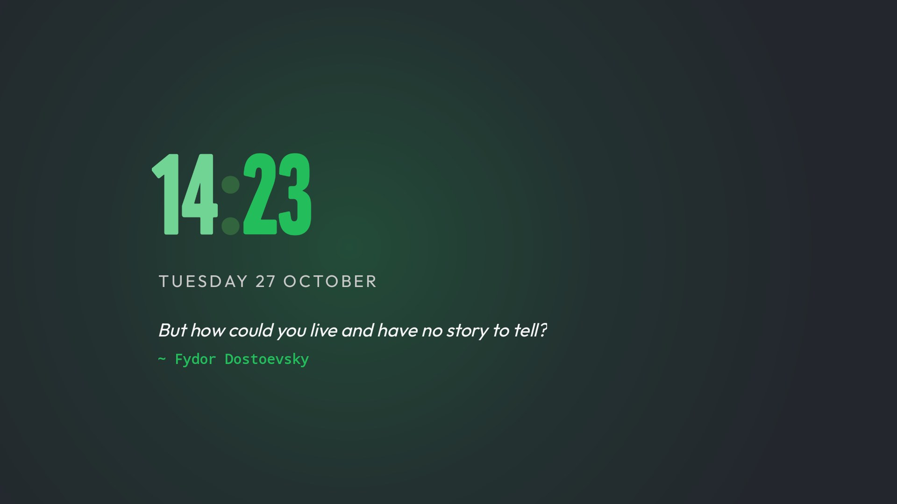</td>
    <td>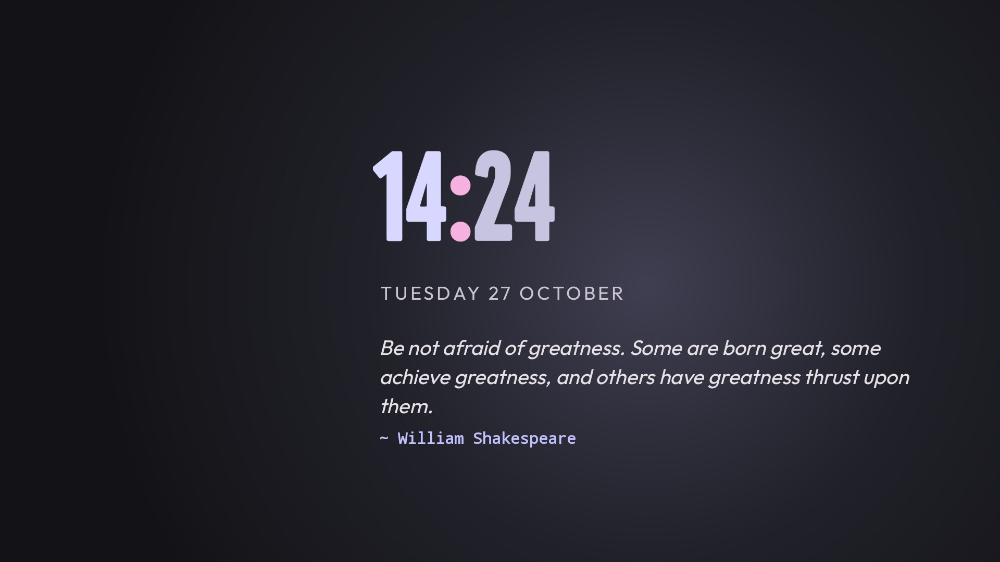</td>
  </tr>
  <tr><td align="center">Darkgreen</td><td align="center">Catppuccin mocha</td></tr>
  <tr>
    <td>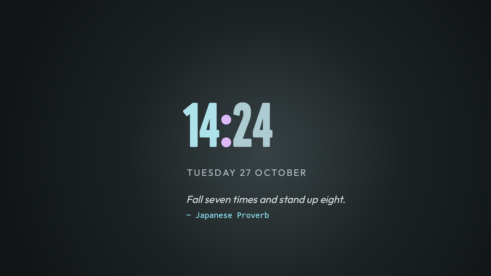</td>
    <td>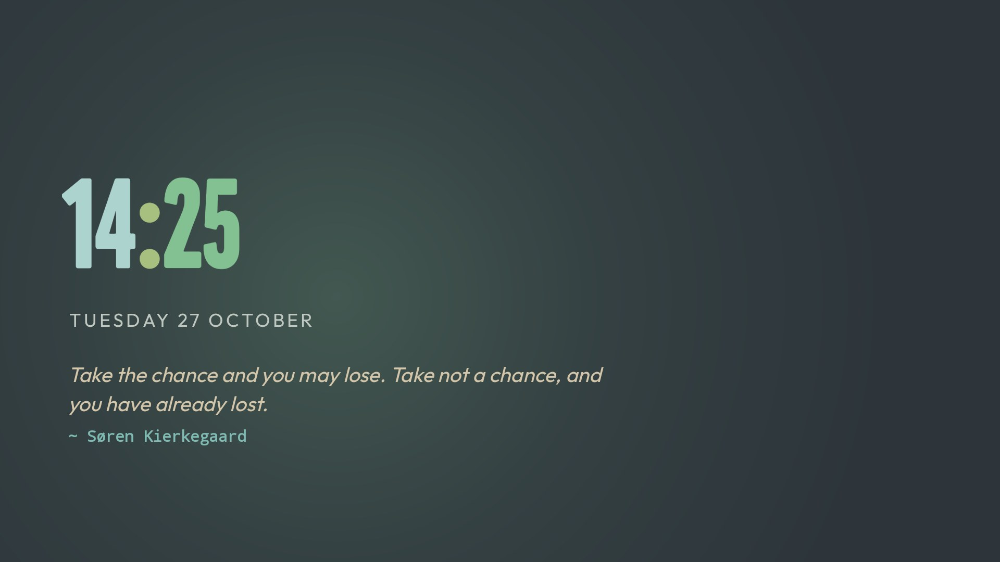</td>
  </tr>
  <tr><td align="center">Gruvbox dark</td><td align="center">Everforest dark</td></tr>
  <tr>
    <td>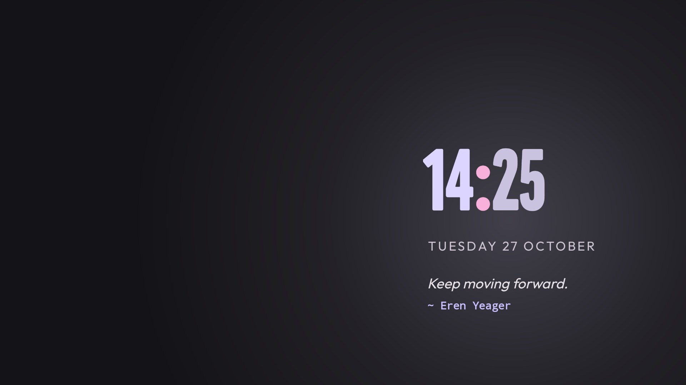</td>
    <td>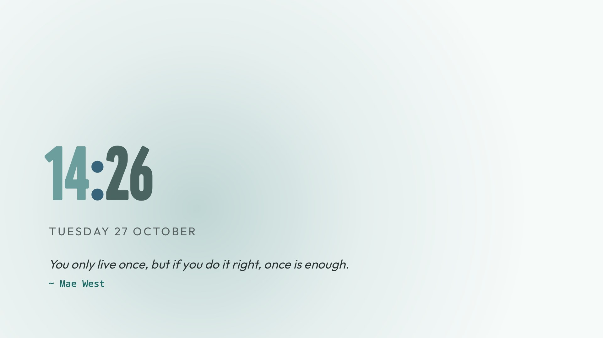</td>
  </tr>
  <tr><td align="center">Rosé Pine</td><td align="center">Caelestia light</td></tr>
</table>

</details>

## Install

You need `adb` on your computer, and a TV on Android 8 or newer.

1. **Turn on debugging on the TV.** Settings → Device preferences → About, press *Build* seven times. Then turn
   on *Network debugging* (or *Wireless debugging*) under Developer options.
2. **Get the APK.** Download `CaelestiaTV.apk` from Releases and put it next to the install script.
3. **Run the script** with your TV's IP address:

```bash
./install.sh <tv-ip>
```

```powershell
.\install.ps1 <tv-ip>
```

Allow the prompt on the TV, and it is done. Turn debugging off again when you are finished.

<details>
<summary><b>What the script changes</b></summary>
<br>

| Step | What happens |
|---|---|
| Launcher and theme | Installs CaelestiaTV, makes it Home, and copies the theme, the schemes and the quotes |
| Debloat | Disables Google's extras that no TV needs ([list](debloat/)). Nothing is uninstalled |
| Speed | Animations at 0.5x, and Android keeps 6 apps in the background instead of 32. On a 2 GB TV that is most of the speed |
| Screensaver | Starts after 15 minutes without a key press |
| Backup | Writes the old state to `backup/` before anything changes |

Add your TV's own bloat list with `--list` (see [debloat](debloat/)), or skip parts with `--no-debloat` and
`--no-tweaks`. To go back: `./restore.sh <tv-ip>`. Without an APK the script builds one from `launcher/`
(JDK 17 and the Android SDK).

</details>

## Make it yours

Everything lives in [`theme/config.json`](theme/config.json). Change it and run the script again.

| Key | What it does |
|---|---|
| `dock_apps` | The apps in the dock, by package name, in order |
| `columns` | Apps per row (5 by default) |
| `clock_size` | The clock in sp, 40 to 120 (100 by default) |
| `scheme` | The scheme to start with, a file name in [`theme/schemes/`](theme/schemes/) |
| `home_idle_clock_minutes` | Minutes on Home before the clock comes up |

The quotes are in [`theme/quotes.json`](theme/quotes.json). Add your own, or empty the list to hide them.

**Extras:** two intents you can bind to a remote key, for example with
[Key Mapper](https://github.com/keymapperorg/KeyMapper). `com.gathin.tvhome.RECENTS` opens the app switcher and
`com.gathin.tvhome.SCREENSAVER` starts the clock. Pressing Home while you are on Home starts it too.

**Tested on** a Sharp AQUOS (Android TV 14, 1.8 GB RAM).

## Credits

- **[CleanYourTV](https://github.com/Gathin23/cleanyourtv)** (MIT), the launcher this is built on
- **[Caelestia](https://github.com/caelestia-dots/shell)** and the themes its schemes come from: Dracula,
  Catppuccin, Gruvbox, Rosé Pine, Tokyo Night, Nord, Everforest
- **[caelestia-sddm](https://github.com/ItsABigIgloo/caelestia-sddm)** by ItsABigIgloo. Its lock screen is the
  inspiration for the clock, the quotes and the look of CaelestiaTV, and the quote list comes from there
- **Fonts:** Outfit (OFL), and Google Sans Flex (OFL) for the clock

## AI declaration

CaelestiaTV is made with AI. Most of the code, the install scripts and this README were written by Claude in
Claude Code (Anthropic). I decided what to build and how it should look, tried every change on my own TV, and
went back and forth until it was right. Claude has been part of it since the first commit; the commits from this
one on also list Claude as co-author.

How I use it: one main chat on **Claude Opus 5.5**, which is the brain. It holds the conversation, makes the
plan, takes the design calls, writes the code that needs context and checks everything before it is used. To save
tokens, bigger jobs that are clearly defined go to subagents on cheaper models, and Opus reviews what comes back:

- **Claude Haiku** for reading: it mapped the CleanYourTV code before the first changes
- **Claude Sonnet** for building to an agreed plan: the colour schemes on every surface, the light schemes,
  the contrast test and the memory and storage rings
- **Opus 5.5** itself for the rest, mostly on medium effort: the review and fixes of Sonnet's work, the clock,
  quotes, palette button, layout and screensaver changes, the install scripts, and the screenshots, taken on the
  TV over adb

Before anything from the internet was cloned or installed, Claude checked it for security first. Testing is on a
real TV over adb: Claude installs the build, takes a screenshot, and I say what to change.

The launcher underneath is CleanYourTV, written by its own authors. The colour schemes, fonts and quotes come from
the projects named under Credits.

<br>

<p align="center">
  
</p>
